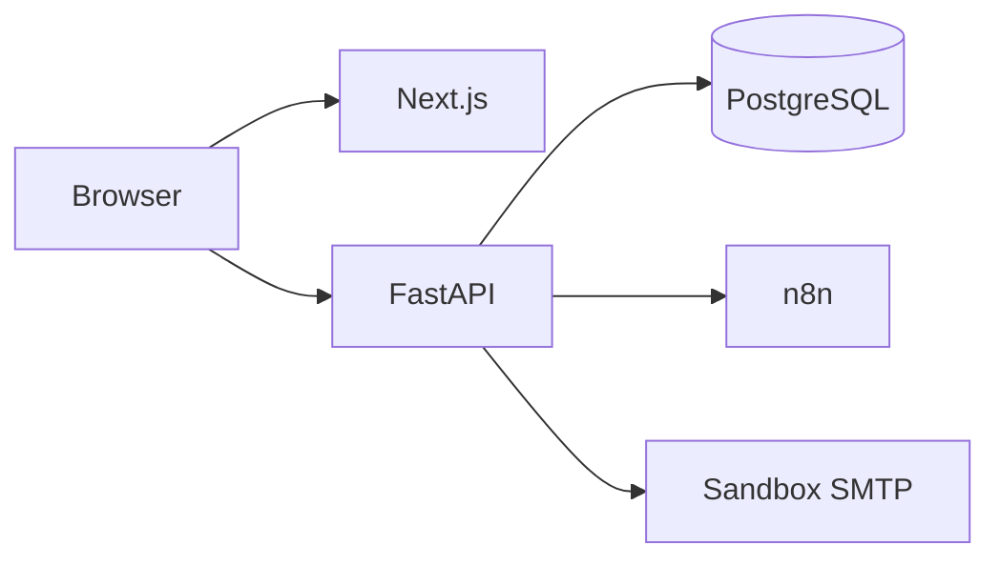
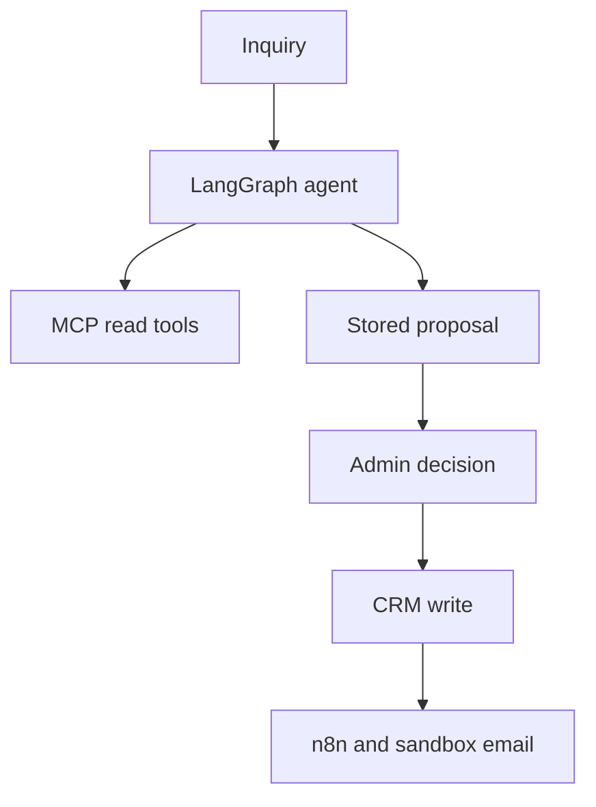

# Architecture

ATLAS is a modular monolith. Day 1 is the platform shell. Day 2 adds CRM, document retrieval, and a read-only assistant. Day 3 adds an inquiry agent that pauses for a human approval before it writes CRM records. Day 4 adds n8n-triggered automation, signed webhooks, sandbox email, and a simulated calendar.

## Backend

`apps/api` is a FastAPI application. HTTP routes live under `/api/v1`. Domain code lives in `app/domains/identity`, `app/domains/crm`, `app/domains/knowledge`, `app/domains/assistant`, `app/domains/agents`, `app/domains/approvals`, and `app/domains/automation`. Shared configuration, database sessions, logging, errors, and session cookies live in `app/core`. OpenAI-compatible chat and embedding clients, the SMTP transport, the simulated calendar, and the n8n client live in `app/integrations`. The read-only MCP server is `python -m app.mcp_server`. The API launches that process with the project virtualenv's Python, or with `ATLAS_MCP_PYTHON` when that interpreter is set. Startup refuses to serve if the selected interpreter cannot import the MCP package.

n8n is an external workflow runner. It receives lead events and calls ATLAS webhooks. n8n answers that delivery before it calls back, so a restart marks an accepted lead run `needs_attention` until the matching callback completes it. The scheduled follow-up lists organization-scoped leads and opens a pending approval. It does not send email. LangGraph still owns inquiry reasoning and the approval pause. Lead scores, analytics, and local traces are stored for the caller's organization. Success and failure of an external action are stored on the execution record.

Webhook signing secrets are sealed with a key derived from `ATLAS_SECRET_KEY` before they are stored. The create response returns the secret once. Later reads, including the automations snapshot, do not include it. Rotating `ATLAS_SECRET_KEY` makes an existing sealed secret unreadable until the integration key is created again. A value stored before sealing still verifies, and it should be replaced.

The webhook rate limit counts requests in the API process that received them. The default is 30 requests per minute for each integration key. Failed logins are counted the same way: 8 per email and 40 per direct client address inside 15 minutes. Neither counter is shared with another process. The login address is the TCP peer, not `X-Forwarded-For`.

`ATLAS_PUBLIC_DEMO=true` refuses a paid model key, live email, an n8n URL, and the development seed. The seed also refuses `ATLAS_ENVIRONMENT=production` because it resets the example passwords.

## Authorization

A session cookie identifies the user. Organization access is loaded from `memberships` for that user. A path organization id is only a lookup key. Roles are `admin` and `staff` on the membership row. CRM, knowledge, assistant, agent, and approval routes require that membership. Mutations also require the CSRF token. Conversations are limited to the user who created them. The assistant can read CRM records and cannot change them. Approving or rejecting an agent action requires the admin role. The agent graph has no approval tool.

## Data

PostgreSQL is provided by the `pgvector/pgvector` image. Migration `0001` enables `vector` and creates the identity tables. `0002` adds companies, contacts, leads, inquiries, and interactions. `0003` adds documents and chunks, including a `vector(1536)` embedding and a full-text `search_vector`. `0004` adds conversations, messages, and message sources. `0005` adds agent runs, agent events, and approvals. `0006` adds the `needs_attention` approval status. `0007` adds webhook keys, workflow runs, execution intents, email deliveries, and simulated calendar bookings. LangGraph also creates its own checkpoint tables in the same database the first time a run starts.

Document files are stored on disk under `ATLAS_STORAGE_DIR`, or `var/atlas-storage` when that setting is empty. Ingestion runs after the upload response, extracts PDF or text content, chunks it with page numbers when the extractor provides them, and writes embeddings. On startup the API indexes documents still marked pending or processing. Replacement of chunks and the ready status commit together, so a repeated run does not duplicate passages. A failed reindex keeps the previous chunks when they exist.

Retrieval mixes cosine distance and Postgres full-text rank, and it only returns chunks from the caller's organization. `ATLAS_MAX_COSINE_DISTANCE` defaults to 0.55, where distance is 1 - cosine similarity. Neighbors farther than that are not candidates. A returned chunk is kept as model context when it shares a content word with the query, or when a vector-only neighbor is at or below distance 0.45. A full-text match is one way that shared wording is detected. One content word is enough, so a question with extra unmatched words can still return the passage it names. That line sits between measured relevant paraphrases (0.37–0.43) and an unsupported address question (0.48) for nomic-embed-text. Rank position alone does not put a neighbor into that context. Stored citations are chosen later, from the answer text. The same rule applies at 768 and 1536 dimensions.

## Models

Chat and embeddings use configurable OpenAI-compatible HTTP endpoints (`ATLAS_LLM_*` and `ATLAS_EMBEDDING_*`). `openai` and `groq` share the chat client. `openai` and `ollama` share the embedding client. `double` is the deterministic stand-in. Stored widths are 1536 (`chunks.embedding`) and 768 (`chunks.embedding_768`). A query uses the column that matches `ATLAS_EMBEDDING_DIMENSIONS` and the stored `embedding_model`. Responses must contain one vector of the configured width per input, ordered by the provider's `index`. Token counts are stored on the local trace when the provider includes a `usage` object. The chat request does not ask the stream for usage, so an OpenAI chat trace often has no token count. An embedding response that includes usage is stored against the embedding model, and a chat chunk that includes usage is stored against the chat model. Cost is stored only when both prices are configured. An empty API key returns `llm_unconfigured` or `embedding_unconfigured`. Retrieved document and CRM rows are context for the model. A stored citation is a row that contains a number, code, email, or distinctive word the answer states. Retrieval rank is not a citation. The model does not choose the stored ids. A specific fact that appears in none of the supplied rows is replaced, in the stored message, with a sentence that the fact could not be confirmed, and no citation is stored. The stream still emits the model draft; the saved message and the `done` event are the verified text. If neither documents nor CRM records match, the assistant stores a refusal and does not call the model.

## Provenance

Business records carry `origin`: `operational`, `demo`, `evaluation`, or `unknown`. The value is stored on the row. An organization is not itself one of those kinds, because one tenant can hold all four. A document or CRM name is not used to choose an origin. Migration `20261122_0011` adds the column and sets every existing row to `unknown`. It does not relabel historical rows. A user create defaults to `operational` unless the request names another origin. An agent run copies the inquiry. An approval copies the run. A lead created by that approval copies the approval. Updating a lead does not change its origin. An n8n callback updates workflow status and leaves the lead origin in place. Reindexing a document changes chunks and status, not origin. New seed rows are written as `demo`. A row the seed already found is left as stored. Analytics, workflow history, monitoring lists, and the agent-run list default to `operational`. `scope=all` includes every origin. `scope=unknown` is the legacy view.

## Agent

An agent run loads one inquiry for the caller's organization, asks the configured chat model for a JSON classification, and reads company knowledge and CRM through MCP. The chat client reads server-sent `data:` lines and keeps `choices[0].delta.content`. A non-empty `data:` payload other than `[DONE]` must be JSON, or the call fails. Empty `data:` lines, comments, and events with no text are ignored. Tool-call fragments are ignored. The classification must be one JSON object, with an optional markdown fence, or the run fails. MCP tools return JSON text. A non-JSON tool body fails the call. The MCP server process is bound to that organization. Its tools are `find_contact`, `get_lead`, and `search_company_knowledge`. The knowledge event keeps every tool hit. `evidence` is the subset whose text contains a fact from the classification. That subset does not change the proposal or the approval pause. They do not accept an organization id and they do not write. If the chat key is empty, the run is stored as failed with `llm_unconfigured` and no classification is invented.

The graph then proposes a lead create or update, a customer response, and an appointment. Those proposals are approval rows with a hash of the payload. The run pauses. An admin approves or rejects with the CSRF token. A lead create or update commits the CRM row and the `executed` approval in one transaction. A crash before that commit leaves the approval `approved` and writes nothing. A row already stuck in `executing` from an older process is marked `needs_attention` and is not applied again.

A customer response or appointment is an external action. Approval first stores an execution intent with the payload and a stable idempotency key. One worker claims it. SMTP delivery uses Mailpit or another local server while email mode is `sandbox`. A timeout is `needs_attention` and is not sent again. A refused connection can be tried twice. The calendar adapter in this release is `simulation`: bookings are rows in ATLAS, with no provider event id, and can be cancelled. A rejected or expired approval creates no intent and sends nothing. This is at-least-once delivery with reconciliation. It is not an exactly-once guarantee.

`ATLAS_APPROVAL_TTL_HOURS` defaults to 24. Tool reads retry up to three times. CRM writes are not retried.

## Lead scores, analytics, and diagnostics

Lead scoring trains on a documented synthetic dataset (`lead-synthetic-1`). The label uses a hidden budget band that is not a model feature, and lead status is not a feature. Logistic regression and a shallow decision tree are compared with a referral rule on a held-out fold. The served probability is sigmoid-calibrated on the training fold when that fit succeeds. The artifact lives under `var/atlas-models`, outside the upload directory, and the API does not return its path. A stored prediction is advisory. It does not change the lead, create an approval, or authorize an external action. The score is a synthetic-data demonstration, not a measurement of real conversion. The explanation describes the model that produced the label. A decision tree contributes the splits on the served path. Logistic coefficients are shown only when that model is the one being served. Uploaded documents are not loaded as model artifacts.

Analytics reads the caller's organization. Conversion is won divided by won plus lost. Open leads are excluded, and the rate is absent when that denominator is zero. The lead trend is the last 30 UTC days, including days with zero. There is no revenue metric.

Operation traces are stored locally. Langfuse export runs only when both keys are set, and a Langfuse failure leaves the local row in place with status `unavailable`. Token cost is stored only when the provider reported usage and both prices are configured. Traces omit prompt text, document text, and credential fields. The evaluation suite is a versioned set of deterministic checks. Its results are not live-model accuracy.

## Frontend

`apps/web` is a Next.js App Router client of the API. Authenticated pages call `/api/v1/auth/me`. CRM, knowledge, the assistant, agent runs, approvals, workflows, analytics, and monitoring call the organization routes with the session cookie. Workflows shows automation status, recent runs, sandbox email, and simulated bookings. It does not embed the n8n editor. Analytics and overview counts come from the analytics endpoint. An organization with no leads or inquiries sees an empty state.

## Engineering standards

Cursor rules in `.cursor/rules` record the boundaries above. The review procedure is `.cursor/skills/engineering-review/SKILL.md`. Ruff, mypy, pytest, ESLint, the Next.js build, TypeScript, and gitleaks run in `.github/workflows/ci.yml` and `scripts/check.ps1`. The browser walkthrough is `npm run e2e` in `apps/web`. Deployment, the demo script, and the case study are in `docs/deployment.md`, `docs/demo.md`, and `docs/case-study.md`.

## Diagrams

